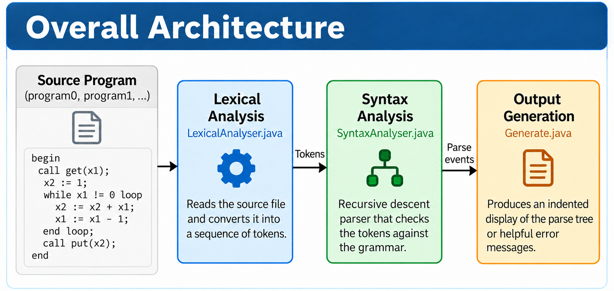
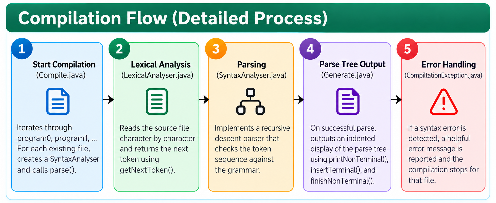
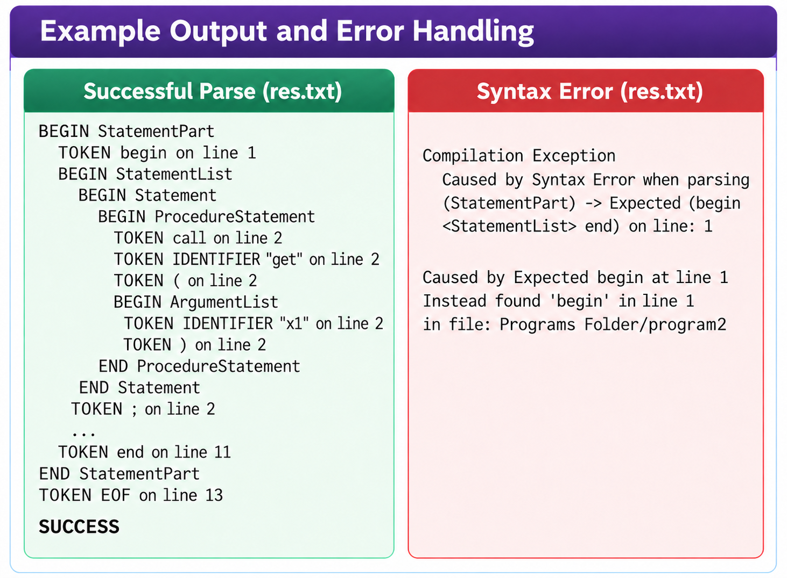
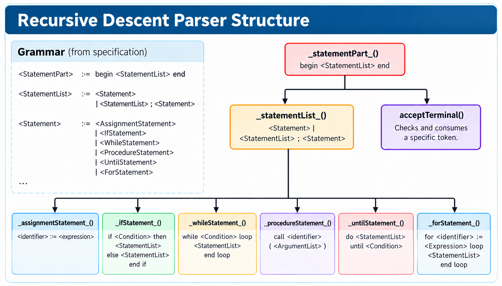
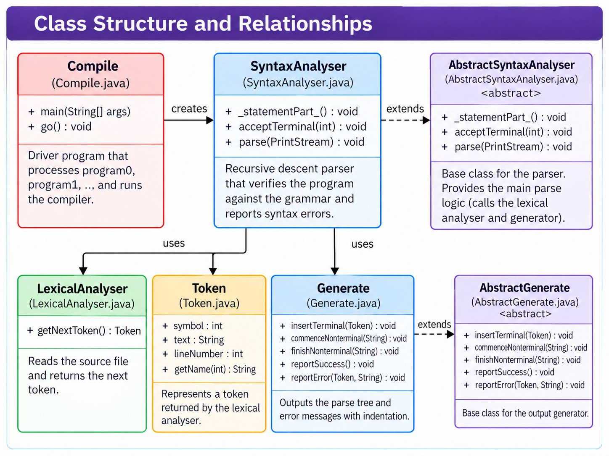

# Recursive Descent Parser

A Java command-line syntax analyser for a small, Ada-like programming language. It reads source files, converts their contents into tokens, and uses recursive descent to check assignments, expressions, procedure calls, conditionals, and loops. Each run produces an indented parsing trace and contextual syntax error reports.

The program checks source syntax. It does not execute the input programs or generate executable code. For example, `call get(x1)` is parsed as a procedure call, rather than prompting you for a number. To use the project, write or select an input file, run the analyser, and inspect its reports.

## Table of Contents

- [Features](#features)
- [How It Works](#how-it-works)
- [Requirements](#requirements)
- [Install Java](#install-java)
- [Download the Project](#download-the-project)
- [Compile and Run](#compile-and-run)
- [Read the Results](#read-the-results)
- [Try Your Own Program](#try-your-own-program)
- [Language Reference](#language-reference)
- [Inspect Tokens Separately](#inspect-tokens-separately)
- [Project Files](#project-files)
- [Clean Generated Files](#clean-generated-files)
- [Troubleshooting](#troubleshooting)

## Features

- Character-by-character lexical analysis with token text and line numbers.
- Recursive descent parsing with an end-of-file check after the outer program block.
- Numeric and string assignments, arithmetic expressions, and comparisons.
- `if`/`else`, `while`, `do`/`until`, and `for` statements.
- Procedure call syntax with identifier arguments.
- Indented trace entries showing tokens and entry into and exit from grammar rules.
- Error messages containing the filename, unexpected token, and parsing context.
- Batch processing of consecutively numbered input files.
- Standard Java library only, with no external libraries or build tools required.

## How It Works

The illustration shows the overall data flow. Use the examples and language reference below for exact accepted syntax.



1. `Compile` searches `Programs Folder` for `program0`, `program1`, and subsequent numbered files.
2. `LexicalAnalyser` reads each file and returns `Token` objects.
3. `SyntaxAnalyser` selects a parsing method using the next token and checks the input against the language rules.
4. `Generate` prints token and grammar-rule events as parsing progresses.
5. A successful parse ends with `SUCCESS`. On a syntax error, the parser stops processing that file and writes an exception trace to `res.txt`.
6. The driver continues with the next numbered file. It stops when the next filename does not exist.

The output is a text trace of the parsing process, rather than a stored abstract syntax tree. Syntax validation does not check variable declarations, types, procedure implementations, or the numerical results of expressions.

### Compilation Flow

The flow starts with input discovery, followed by tokenisation and syntax checking. Trace entries are emitted as parsing progresses, so even an invalid file produces a partial trace before its error report.



In the illustration, `printlnNonTerminal()` is a conceptual label. The implementation marks grammar-rule boundaries with `commenceNonterminal()` and `finishNonterminal()`, then continues to the next file after reporting a syntax error.

## Requirements

| Requirement | Purpose |
| --- | --- |
| Java Development Kit (JDK) | Provides `javac` to compile the project and `java` to run it. |
| Terminal | PowerShell or Command Prompt on Windows, or a terminal on macOS/Linux. |
| Text editor | Lets you view reports and write input programs. |
| Git (optional) | Lets you clone the repository instead of downloading a ZIP. |

A JDK such as Java 21 is a suitable starting point. A runtime-only installation (JRE) does not provide the compiler. No Maven, Gradle, IDE, Python, or separate parser generator is needed.

## Install Java

If both `java -version` and `javac -version` already work, you can skip to [Download the Project](#download-the-project).

### Windows

1. Open the official [Eclipse Temurin downloads page](https://adoptium.net/temurin/releases/).
2. Select a JDK release such as Java 21, Windows, and the architecture matching your computer. Choose x64 for most computers or ARM64 for an ARM device.
3. Download the JDK `.msi` installer and run it.
4. Enable the installer's option to add Java to `PATH`. You can also enable its `JAVA_HOME` option.
5. Finish installation and open a new PowerShell or Command Prompt window.
6. Check both commands:

```text
java --version
javac --version
```

Both commands should print a version. If `javac` is missing, check that you installed the JDK and that its `bin` directory is on `PATH`.

### macOS

1. Open the [Eclipse Temurin downloads page](https://adoptium.net/temurin/releases/).
2. Select a JDK release such as Java 21 and macOS. Choose aarch64 for Apple Silicon or x64 for an Intel Mac.
3. Download and run the `.pkg` installer.
4. Open a new terminal and run `java -version` and `javac -version`.
5. If you have multiple JDKs and want to select Java 21 for the current terminal, run:

```sh
export JAVA_HOME=$(/usr/libexec/java_home -v 21)
export PATH="$JAVA_HOME/bin:$PATH"
```

### Linux

1. Follow the official [Temurin installation instructions](https://adoptium.net/installation/) for your distribution to configure its package repository.
2. Install the JDK package for your chosen version using those instructions. Alternatively, install an OpenJDK development package from your distribution's repositories.
3. Open a terminal and run `java -version` and `javac -version`.
4. Ensure both commands use the intended JDK before compiling.

## Download the Project

### Option 1: Download a ZIP

1. Open this repository on GitHub.
2. Select **Code**, then **Download ZIP**.
3. Extract the ZIP into a folder you can write to.
4. Open a terminal in the extracted folder that contains `Compile.java` and `README.md`.
5. Keep `Programs Folder` alongside the Java files, with its name and contents intact.

### Option 2: Clone with Git

1. Install Git from the official [Git installation page](https://git-scm.com/downloads) if needed.
2. On this repository's GitHub page, select **Code** and copy the HTTPS clone URL.
3. Run the following command, replacing `REPOSITORY_URL` with that URL:

```text
git clone REPOSITORY_URL
```

4. Change into the downloaded directory containing `Compile.java`.

For example, use `cd "C:\Projects\recursive-descent-parser"` in PowerShell or `cd "$HOME/Projects/recursive-descent-parser"` on macOS/Linux, replacing the example path with your actual folder.

## Compile and Run

Run all commands from the directory containing the Java source files. The program resolves its input and output paths relative to the current working directory.

### Direct Commands on Windows, macOS, or Linux

Compile the Java sources:

```text
javac *.java
```

If compilation succeeds, run the driver and save its standard output:

```text
java -cp . Compile > output.txt
```

This creates or replaces `output.txt`. The driver also creates or replaces `res.txt` in the same directory. Existing reports are overwritten, so save copies first if you want to compare runs.

To see the parsing trace directly in your terminal instead:

```text
java -cp . Compile
```

The driver still writes syntax exception reports to `res.txt` in this mode, but it does not update `output.txt`.

### Included Windows Scripts

In PowerShell, run:

```powershell
.\compile.bat
.\execute.bat
```

In Command Prompt, run:

```bat
compile.bat
execute.bat
```

Each script pauses at the end. Press a key to continue. `compile.bat` compiles the sources. `execute.bat` runs `Compile` and redirects its trace to `output.txt`.

Use the direct commands on macOS/Linux. The repository does not include a Makefile or Unix shell scripts.

### Run Again After Changes

- After editing Java source, compile again and then run the driver.
- After editing only input programs, run the driver again. Recompilation is unnecessary.
- You do not need to delete old `.class` files or reports before a normal rerun.

## Read the Results

The left panel shows how nested `BEGIN`, `TOKEN`, and `END` entries describe a successful parse, ending with `SUCCESS`. This trace belongs in `output.txt`, despite the image's `res.txt` label.



The right panel illustrates the exception report in `res.txt`, where nested causes connect a grammar rule to the unexpected token and its location. The error text is schematic. An actual report might identify `begim` where `begin` was expected.

### Parsing Trace In output.txt

The trace identifies the current input with a `FILE` entry. Within that file's section:

| Entry | Meaning |
| --- | --- |
| `START` / `FINISH` | Beginning and end of the overall batch. |
| `FILE ...` | Input file about to be parsed. |
| `BEGIN ...` | Entry into a grammar rule. |
| `TOKEN ... on line ...` | A token was accepted. |
| `END ...` | Successful completion of a grammar rule. |
| `SUCCESS` | The complete input, including end of file, was accepted. |
| `ERROR: ...` | Parsing failed at the displayed token. |

Indentation shows nesting within the grammar. Trace lines appear while parsing, so a failed file can have a partial trace without matching `END` entries for every `BEGIN`.

A shortened successful section looks like this:

```text
FILE Programs Folder\program0
BEGIN StatementPart
    TOKEN begin on line 1
    BEGIN StatementList
        ...
    END StatementList
    TOKEN end on line 12
END StatementPart
TOKEN EOF on line 13
SUCCESS
```

The ellipsis is explanatory, and line numbers depend on the input file, including blank lines. Path separators differ between operating systems.

### Exception Details In res.txt

`res.txt` contains reports for files that failed syntax analysis. A report starts with `Compilation Exception` and includes nested `Caused by` entries, ending with a more specific token, line, and filename message. Read the last detailed cause to locate the immediate problem, and the earlier entries to see which grammar rules were being parsed.

Only the first syntax error in each file is reported. Fix that error and run again to reveal any subsequent errors. Successful files do not add success messages to `res.txt`, so an empty file means no syntax exceptions were recorded in that run.

### Included Sample Results

The repository contains 12 input programs. The current implementation produces these results:

| Result | Files |
| --- | --- |
| Accepted | `program0`, `program1`, `program6`, `program9`, `program10`, `program11` |
| Syntax error reported | `program2`, `program3`, `program4`, `program5`, `program7`, `program8` |

The samples include malformed syntax to demonstrate error reporting. After `program11`, the message `Programs Folder\program12 does not exist` is the normal end-of-batch condition when no extra input has been added.

The driver can exit with status zero even when inputs have syntax errors. Check each file's `SUCCESS` or `ERROR` entries and `res.txt` to determine its result.

## Try Your Own Program

1. Create a plain-text file named `program12` inside `Programs Folder`. Do not add a `.txt` extension. On Windows, enable file extensions in File Explorer to check the actual name.
2. Paste the following input and save it:

```text
begin
count := 3;
total := 0;
while count > 0 loop
    total := total + count;
    count := count - 1
end loop;
message := "done";
call put(message)
end
```

3. From the repository root, run `java -cp . Compile > output.txt`.
4. Find `FILE Programs Folder\program12` in `output.txt`. Its trace should end with `SUCCESS`.
5. To explore error reporting, change `count := 3` to `count = 3`, save, and rerun. Inspect that file's trace and the corresponding report in `res.txt`.

The analyser validates the loop and call syntax without calculating `total` or printing `message` as program output.

Add further inputs as `program13`, `program14`, and so on. Numbering must be consecutive: if `program12` is missing, the driver will not search for `program13`. The driver does not accept a filename argument. Running `java Compile myfile` does not select `myfile`.

## Language Reference

The diagram follows parsing from `_statementPart_()` into the statement list and the methods for individual statement types. Each method recognises its part of the grammar, while `acceptTerminal()` checks and consumes the expected token.



The `for` statement box is schematic. The implementation requires a parenthesised initialisation, condition, and update separated by semicolons, followed by `do` and a body ending with `end loop`, as shown below.

### Program Structure and Separators

A complete input has the following form:

```text
begin
    statement;
    anotherStatement
end
```

Here `statement` and `anotherStatement` are placeholders for real statements. Each block must contain at least one statement. Semicolons separate statements. Do not put a trailing semicolon immediately before `end`, `else`, or `until`. Nothing except whitespace or comments may follow the outer `end`.

### Tokens and Expressions

| Construct | Syntax or example |
| --- | --- |
| Identifier | Starts with a letter, followed by letters or digits: `x1`, `total`. Underscores are not accepted. |
| Number | Digits with an optional decimal part: `12`, `3.5`. |
| String | Text enclosed in double quotes: `"hello"`. |
| Comment | `--` starts a comment extending to the end of the line. |
| Assignment | `total := total + count` or `message := "hello"`. |
| Arithmetic | `+`, `-`, `*`, `/`, `%`, and parentheses. |
| Comparison | `>`, `>=`, `=`, `!=`, `<`, `<=`. |
| Condition | Identifier, comparison operator, then identifier, number, or string: `count > 0`. |
| Procedure call | `call put(total)` or `call combine(x1, x2)`. Arguments are identifiers. |

Keywords are recognised without regard to letter case. Use lowercase keywords for consistency with the examples. Reserved words include `begin`, `call`, `do`, `else`, `end`, `float`, `for`, `if`, `integer`, `is`, `loop`, `procedure`, `string`, `then`, `until`, and `while`.

Multiplication, division, and remainder are parsed within terms, before addition and subtraction. The implementation recurses on the remaining expression or term, producing right-nested traces for chains of operators. Parentheses explicitly group expressions.

Use binary subtraction such as `0 - 1`. Unary minus is not supported. Conditions require an identifier on the left and do not support arithmetic operands or `and`, `or`, or `not`. Strings can be assigned directly or used as the right operand of a condition, but are not arithmetic factors. Use closed, single-line quoted strings without embedded double quotes or escape sequences.

Although some declaration-related words are reserved by the lexer, the parser accepts statement blocks rather than variable or procedure declarations. The implementation also accepts a bare call such as `call refresh`. If parentheses are present, the argument list must contain at least one identifier.

### Conditional Example

```text
begin
if count > 0 then
    message := "positive"
else
    message := "zero or negative"
end if
end
```

The `else` branch is optional. Close the statement with `end if`.

### Loop Examples

Pre-condition loop:

```text
begin
while count > 0 loop
    count := count - 1
end loop
end
```

Post-condition loop:

```text
begin
do
    count := count - 1
until count = 0
end
```

Counted loop:

```text
begin
for (index := 0; index < 3; index := index + 1) do
    call put(index)
end loop
end
```

These examples show accepted syntax. The parser does not evaluate the conditions or run the loop bodies.

## Inspect Tokens Separately

After compiling the Java files, start the lexer's standalone entry point:

```text
java -cp . LexicalAnalyser
```

At the `file?` prompt, type a filename and press Enter. For example, on Windows:

```text
Programs Folder\program0
```

On macOS/Linux, use `Programs Folder/program0`. Enter the path without surrounding quotes at this prompt, even though it contains a space.

The lexer prints token names, token text, and line numbers through `EOF`. This mode shows tokenisation without checking whether the token sequence forms a valid program.

## Project Files

The diagram shows how `Compile` creates the parser, which uses the lexer, token objects, and trace generator. `SyntaxAnalyser` and `Generate` extend their abstract base classes to provide parsing rules and indented output.



The parser inherits `parse()` from `AbstractSyntaxAnalyser`. The driver's `go()` method is private, despite the public visibility marker shown in the image.

| File or directory | Role |
| --- | --- |
| `Compile.java` | Application entry point, sequential file discovery, and results stream setup. |
| `LexicalAnalyser.java` | Tokenisation, reserved words, comments, and standalone lexer entry point. |
| `Token.java` | Token constants, token text, line numbers, and display names. |
| `AbstractSyntaxAnalyser.java` | Parser interface and parse lifecycle, including end-of-file validation and exception reporting. Made in collaboration with Dr. Paul Rayson. |
| `SyntaxAnalyser.java` | Recursive descent rules and terminal acceptance. |
| `AbstractGenerate.java` | Base interface and default trace output methods. Made in collaboration with Dr. Paul Rayson. |
| `Generate.java` | Indented tracing, success messages, and initial syntax error reports. |
| `CompilationException.java` | Nested syntax error causes and bounded trace formatting. |
| `Programs Folder/` | Numbered plain-text input programs without filename extensions. |
| `compile.bat` | Windows compilation helper. |
| `execute.bat` | Windows execution helper that saves standard output. |
| `makeClean.bat` | Windows cleanup helper for root-level `.class` and `.txt` files. |
| `output.txt` | Saved parsing trace from a redirected run. |
| `res.txt` | Syntax exception reports from the most recent run. |
| `assets/` | Project illustrations. |

## Clean Generated Files

Cleanup is optional. From the repository root, remove generated bytecode and the two reports in PowerShell:

```powershell
Remove-Item -Path .\*.class
Remove-Item -LiteralPath .\output.txt, .\res.txt
```

In Command Prompt:

```bat
del *.class
del output.txt res.txt
```

On macOS/Linux:

```sh
rm -f ./*.class ./output.txt ./res.txt
```

The included `makeClean.bat` deletes every `.class` and every `.txt` file in the current directory, so use it only when all matching files there are disposable. It does not target the extensionless inputs inside `Programs Folder`. Recompile before running again after deleting bytecode.

## Troubleshooting

| Symptom | What to check |
| --- | --- |
| `java` or `javac` is not recognised | Install a JDK, add its `bin` directory to `PATH`, and open a new terminal. |
| `java` works but `javac` does not | A JRE alone is insufficient. Install the JDK. |
| `Could not find or load main class Compile` | Run `javac *.java` successfully, stay in the source directory, and use `java -cp . Compile`. |
| `UnsupportedClassVersionError` | Use a matching compiler and runtime, then recompile. Check both version commands. |
| `Programs Folder\program0 does not exist` | Start in the repository root and check the folder name and extensionless filename. |
| A later input is skipped | Fill any numbering gap. The first missing numbered input ends discovery. |
| A sample produces a syntax error | Compare it with the sample-results table. Several samples demonstrate invalid syntax. |
| `res.txt` is empty | Successful parses do not write exception reports. Inspect `output.txt` for `SUCCESS`. |
| Changes do not appear in the results | Recompile after Java edits, rerun the driver, and reopen the newly written reports. |
| An input appears to hang | Check that every string has a closing double quote. The lexer does not diagnose unterminated strings. Stop the run with Ctrl+C before correcting the input. |
| Output files cannot be opened or written | Run in a writable extracted folder and check file permissions. |

For syntax problems, begin with the unexpected token and filename in the report, then inspect the surrounding source and grammar-rule context. Displayed line numbers come from the lexer and include blank lines. They may start at zero for a file with no leading blank line.